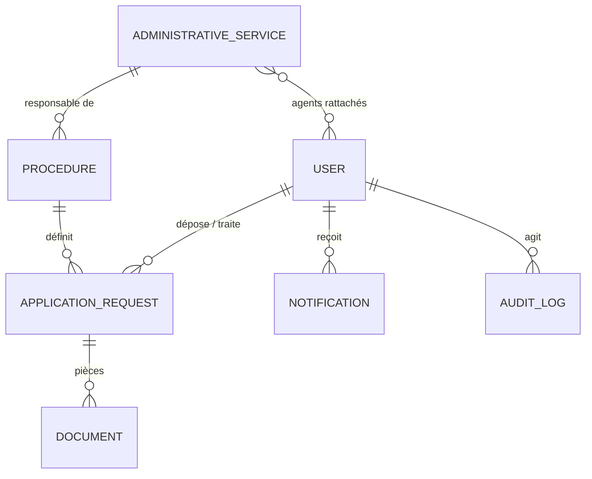
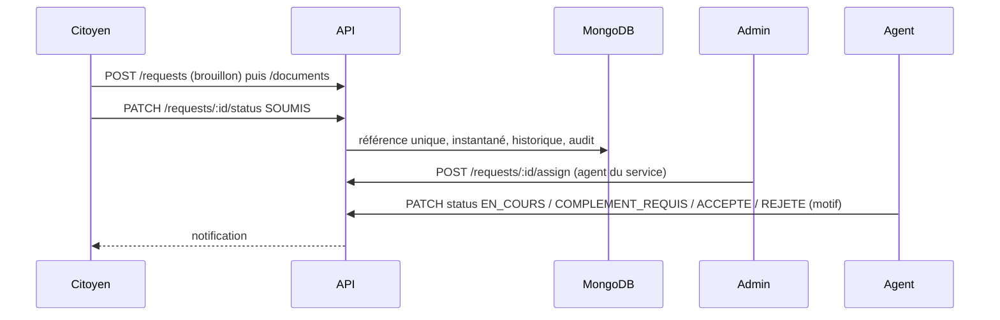

# Architecture

Client React (SPA) → API REST Express (`/api/v1`) → MongoDB (Mongoose). Authentification par cookie HttpOnly (JWT). Fichiers dans un stockage privé local (`server/uploads`, hors dossier public) derrière l'interface `services/storage.js`, remplaçable par un stockage objet. En développement, Vite relaie `/api` vers le port 5000 (même origine, pas de CORS).

Serveur : `routes/` (HTTP + contrôle d'accès), `services/` (workflow, statistiques, stockage), `middlewares/` (authentification, rôles), `models/` (Mongoose).

## Modèle de données

`APPLICATION_REQUEST` contient l'historique des transitions et un instantané de la procédure figé à la soumission.

## Workflow des dossiers
BROUILLON → SOUMIS → (EN_ATTENTE) → EN_COURS → COMPLEMENT_REQUIS ↔ EN_COURS → ACCEPTE | REJETE → CLOTURE. Transitions, rôles et motifs obligatoires : `server/src/services/workflow.js` (vérifiés côté serveur).

Indicateurs : dossiers soumis = hors brouillons ; délai moyen = soumission → décision (ACCEPTE/REJETE) sur les dossiers ayant les deux dates ; sans donnée, la valeur est `null`.
